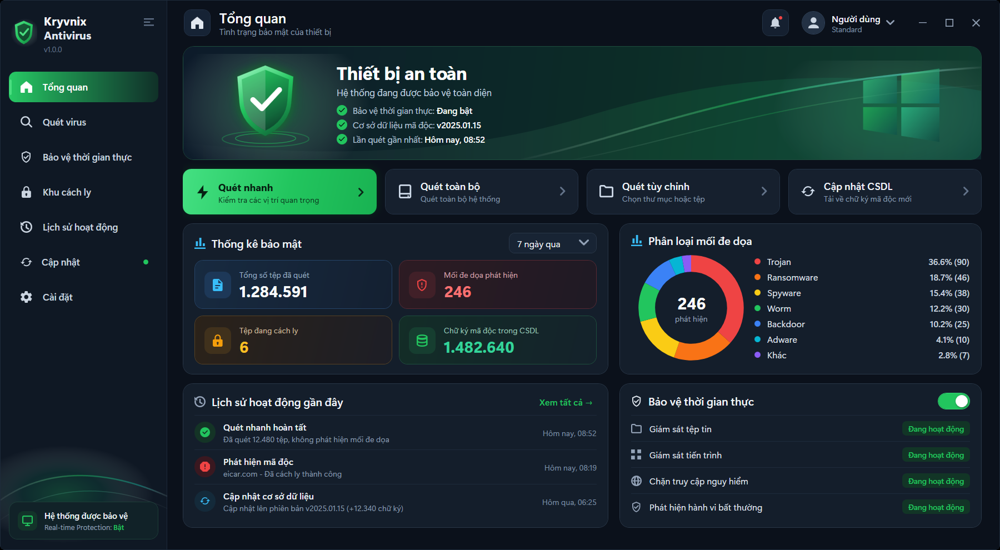
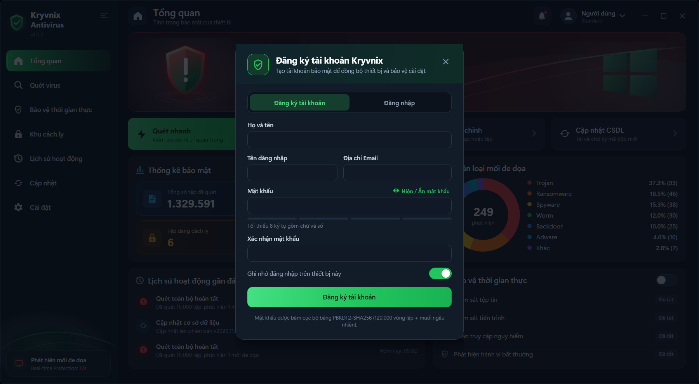

# Kryvnix Antivirus v2.0 — Enterprise Endpoint Security Suite

<p align="center">
  <strong>Full-Stack Windows Endpoint Protection Platform: C# / .NET 10 WPF (MVVM) + C++20 Native Named Pipe Engine + ASP.NET Core 10 SignalR/JWT API + React TypeScript Admin Console + Offline AI PE Classifier + AES-256-GCM DPAPI Quarantine Vault.</strong>
</p>

<p align="center">
  
  
  
  
</p>

---

## Giao diện ứng dụng

### Tổng quan (Dashboard)


### Đăng ký & Quản lý tài khoản (PBKDF2-SHA256)


---

## Hệ sinh thái công nghệ v2.0

### 1. Desktop Endpoint Agent (`desktop/KryvnixAntivirus.Desktop` — C# / .NET 10 / WPF)
- **Fluent Dark Windows 11 UI**: Custom `WindowChrome` (Native Snap/Resize, DPI 100%–200%), Sidebar thu gọn mượt (`240px ↔ 72px`), **System Tray** chạy nền và **Menu chuột phải Windows Explorer** (*"Quét bằng Kryvnix Antivirus"*).
- **Dashboard thời gian thực**: Hero Card 5 trạng thái thực (*Protected, Attention Required, Threat Detected, Protection Disabled, Service Unavailable*), 4 thao tác nhanh, thống kê theo mốc thời gian và biểu đồ Doughnut **LiveCharts2**.
- **Đa tầng phát hiện mã độc**:
  - Tra cứu chữ ký **SHA-256** (SQLite), nhận diện chuẩn **EICAR**, luật **YARA-style**.
  - **Windows Authenticode (`WinVerifyTrust` Win32 P/Invoke)**: Tự động xác thực chữ ký số gốc của Windows để giảm cảnh báo giả (False Positive).
  - **Offline AI PE Malware Classifier**: Mô hình phân loại tuyến tính 8 đặc trưng cấu trúc PE (Entropy, RWX sections, Packer, Import density, Size anomaly, Authenticode) chấm xác suất mã độc cục bộ `< 2ms`.
  - **Deep Archive Scanner (Chống Zip Bomb)**: Quét sâu tệp nén (`.zip`, `.docm`, `.xlsm`, `.jar`, `.nupkg`) trực tiếp trong RAM với kiểm soát tỷ lệ nén chống Zip Bomb.
  - **Threat Intelligence Lookup**: Tra cứu SHA-256 trực tuyến qua **MalwareBazaar API** và **VirusTotal v3 API** (tùy chọn API Key).
- **Bảo vệ thời gian thực & Hệ thống**:
  - `FileSystemWatcher` giám sát tệp thời gian thực + Bộ lọc ngoại lệ.
  - **Process Monitor** (liệt kê tiến trình + xác thực Authenticode + nút dừng tiến trình).
  - **Registry Startup Guard** (kiểm tra khóa `HKCU/HKLM\...\Run`, phát hiện và gỡ lệnh khởi động đáng ngờ).
- **Khu cách ly mã hóa AES-256-GCM + Windows DPAPI (`ProtectedData`)**: Khóa AES-256 được bảo vệ bởi DPAPI gắn theo người dùng Windows (`KDP1`), tệp cách ly `.kqv` hỗ trợ Khôi phục / Lưu nơi khác / Xóa vĩnh viễn.
- **Tài khoản & Cập nhật**: Đăng ký/Đăng nhập/Đổi mật khẩu băm **PBKDF2-SHA256 (120.000 vòng)**; cập nhật chữ ký xác thực **Ed25519** qua SQLite transaction.

### 2. Native C++20 Engine (`engine/` — Win32 Named Pipe Server)
- Biên dịch thuần C++20 thành `kryvnix_engine.exe` (SHA-256, Entropy, YARA/EICAR CLI + Win32 Named Pipe Server `\\.\pipe\KryvnixAntivirusPipe` giao tiếp trực tiếp với ứng dụng WPF).

### 3. Central Management Backend (`backend/KryvnixAntivirus.Api` — ASP.NET Core 10)
- REST API + **SignalR Hub (`/hubs/security`)** + **JWT Bearer RBAC** + **Ed25519 Signed Signature Feed** (`/api/v1/updates/latest`) + Device Heartbeat + Remote Scan dispatch + Audit Logs.

### 4. Enterprise Admin Web Console (`admin-web/` — React 19 + TypeScript + Vite)
- Bảng điều khiển quản trị tập trung: Tổng quan hạm đội thiết bị, Quản lý máy trạm + **Quét từ xa**, CRUD chữ ký SHA-256, Quản lý luật YARA, Nhật ký kiểm toán và xuất báo cáo JSON.

### 5. Bộ cài đặt Windows & CI/CD (`installer/` & `.github/workflows/release.yml`)
- Script **Inno Setup 6** ([installer/KryvnixAntivirus.iss](installer/KryvnixAntivirus.iss)) đóng gói trình cài đặt Windows hoàn chỉnh kèm shortcut và menu chuột phải.

---

## Tải và chạy nhanh (Windows x64)

1. Mở mục **[Releases](https://github.com/0xshijn/Kryvnix-Antivirus/releases)** trên GitHub.
2. Tải về **`KryvnixAntivirus.exe`** (chạy trực tiếp 1 tệp duy nhất, **không cần cài .NET 10**) hoặc gói **`KryvnixAntivirus-v2.0.0-win-x64.zip`** (gồm cả `KryvnixAntivirus.exe` + `kryvnix_engine.exe`).
3. Nhấp đúp **`KryvnixAntivirus.exe`** để sử dụng ngay trên Windows 10/11 x64.

---

## Chạy toàn bộ hệ sinh thái từ mã nguồn

```powershell
# 1. Build & chạy toàn bộ 16 unit test (.NET 10)
dotnet restore KryvnixAntivirus.slnx
dotnet build KryvnixAntivirus.slnx -c Release
dotnet test desktop/KryvnixAntivirus.Tests/KryvnixAntivirus.Tests.csproj -c Release

# 2. Chạy Native C++20 Named Pipe Engine (tùy chọn - bật chế độ C++ Native Service)
.\engine\bin\kryvnix_engine.exe --serve

# 3. Chạy Backend API (ASP.NET Core 10 - http://localhost:8080)
dotnet run --project backend/KryvnixAntivirus.Api/KryvnixAntivirus.Api.csproj

# 4. Chạy React Admin Dashboard (http://localhost:5173)
cd admin-web && npm install && npm run dev

# 5. Hoặc khởi chạy trọn bộ Server Stack bằng Docker Compose
docker compose up -d --build
```

---

## Cấu trúc dự án

```text
├── desktop/
│   ├── KryvnixAntivirus.Desktop/   # Ứng dụng WPF .NET 10 (MVVM, Authenticode, AI PE, DPAPI, LiveCharts2)
│   └── KryvnixAntivirus.Tests/     # Bộ kiểm thử đơn vị xUnit (16 tests)
├── engine/                         # Native C++20 Engine + Win32 Named Pipe Server (kryvnix_engine.exe)
├── backend/
│   └── KryvnixAntivirus.Api/       # ASP.NET Core 10 REST API + SignalR + JWT RBAC + Ed25519 Feed
├── admin-web/                      # React 19 + TypeScript Enterprise Admin Dashboard
├── database/                       # Migration SQL PostgreSQL 16 & SQLite 3
├── installer/                      # Inno Setup 6 Windows Installer script
├── docs/                           # Kiến trúc hệ thống, ERD & ảnh giao diện
├── docker-compose.yml              # PostgreSQL 16 + Backend API + React Admin + Adminer
└── KryvnixAntivirus.slnx           # Solution .NET 10
```
