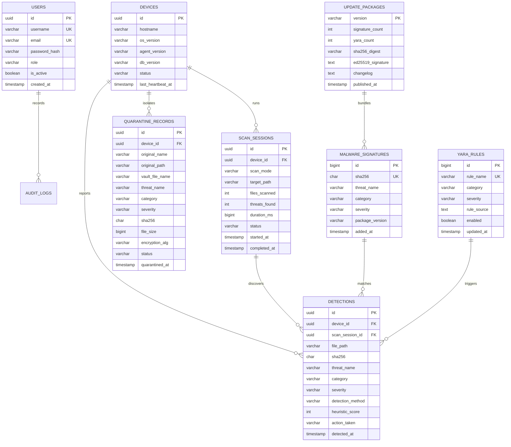

# Kryvnix Antivirus — Architecture & 10-Phase Implementation Plan

## 1. System Overview

**Kryvnix Antivirus** is a commercial-grade Windows endpoint security platform built with a hybrid architecture:

- **Desktop Client (C# / .NET 10 / WPF / MVVM)**: Modern Fluent Dark UI with custom Windows 11 chrome, system tray integration, LiveCharts2 analytics, local SQLite persistence, Named Pipe IPC client, and hybrid local scanning/quarantine fallback.
- **Native Protection Engine & Windows Service (C++20 / CMake / vcpkg)**: High-throughput multithreaded file scanner, SHA-256 signature lookup, libyara rule engine, PE parser & heuristic analyzer, AES-256-GCM encrypted quarantine vault, and real-time file system monitor exposed over Windows Named Pipe (`\\.\pipe\KryvnixAntivirusPipe`).
- **Central Management Backend & Admin Dashboard (PostgreSQL + REST API + React)**: RBAC authentication, endpoint inventory, malware signature & YARA rule CRUD, Ed25519-signed signature package builder, device heartbeat, and telemetry analytics.

## 2. Entity-Relationship Diagram (ERD)

## 3. Windows Named Pipe IPC Protocol

- **Pipe Name**: `\\.\pipe\KryvnixAntivirusPipe`
- **Framing**: 4-byte little-endian `uint32` payload length prefix followed by UTF-8 JSON object.
- **Message Types**:
  - `ping` / `get_status` -> returns engine version, service health, real-time module states, active DB version.
  - `start_scan` (`Quick`, `Full`, `Custom`, `targets[]`) -> streams `scan_progress` frames and `detection_found` frames until `scan_completed`.
  - `pause_scan` / `resume_scan` / `cancel_scan` -> controls active scan job.
  - `quarantine_file` / `restore_file` / `delete_quarantine` -> executes privileged vault operations.
  - `set_realtime_config` -> toggles File Monitor, Process Monitor, Network Shield, Behavior Detection, and Exclusion list.
  - `apply_update` -> verifies Ed25519 signature and applies atomic SQLite signature package update.

## 4. 10-Phase Roadmap Checklist

- **Phase 01 · Project Setup (Tuần 1)**: Git repo, CMake & vcpkg manifest, PostgreSQL & SQLite migrations, ERD, Docker Compose.
- **Phase 02 · Core Scanner (Tuần 2–3)**: File Scanner, SHA-256 Engine, Signature Repository, Multithread Scan Queue, CLI, Unit Tests.
- **Phase 03 · Detection Engine (Tuần 4–5)**: libyara integration, PE Parser, Entropy Analyzer, Import Analyzer, Heuristic Scoring, Detection Repository.
- **Phase 04 · Quarantine & Service (Tuần 6)**: AES-256-GCM Encrypted Quarantine Storage, Restore & Delete, Windows Service, Named Pipe IPC, ACL tests.
- **Phase 05 · Backend API (Tuần 7)**: Auth & RBAC, Device Management, Signature CRUD, Scan & Detection API, Audit Logging.
- **Phase 06 · Desktop GUI (Tuần 8)**: C# .NET 10 WPF MVVM app — Dashboard, Quick/Full/Custom Scan, Scan Progress, Realtime Protection, Quarantine, History, Updates, Settings.
- **Phase 07 · Update & Sync (Tuần 9)**: Signature Package Builder, Ed25519 Verification, SQLite Update Transaction, Offline Sync Queue, Device Heartbeat.
- **Phase 08 · Realtime Protection (Tuần 10)**: File System Monitor, Event Queue, Realtime Scanner, Exclusion Filter, Security Policies.
- **Phase 09 · Admin Dashboard (Tuần 11)**: React Dashboard, Endpoint Management, Malware DB & YARA Management, Reports & Statistics.
- **Phase 10 · Testing & Release (Tuần 12)**: EICAR Test, False Positive Test, Performance Benchmark, Security Test, Windows Installer, Documentation.
